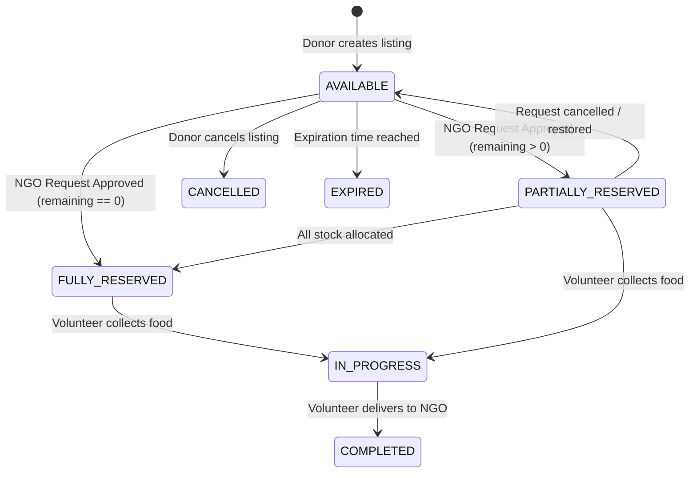
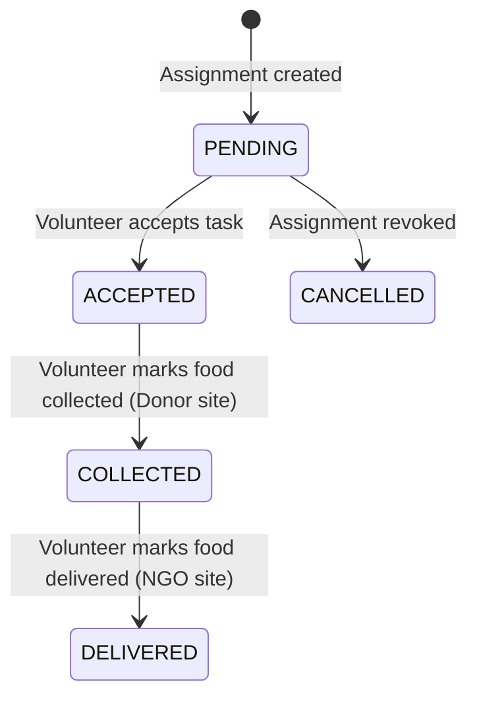

# 🍲 Surplus Food Rescue & Redistribution Coordination Platform

[](https://www.oracle.com/java/)
[](https://spring.io/projects/spring-boot)
[](https://react.dev/)
[](https://vitejs.dev/)
[](https://www.mysql.com/)
[](https://spring.io/projects/spring-security)
[](LICENSE)

> An enterprise-grade, full-stack redistribution coordination platform designed to bridge the gap between commercial surplus food donors (banquet halls, caterers, hotels, corporate cafeterias) and certified hunger relief NGOs, powered by real-time volunteer logistics, pessimistic inventory locking, and end-to-end delivery tracking.

---

## 📌 Table of Contents

- [Overview & Mission](#-overview--mission)
- [Key Features by Role](#-key-features-by-role)
- [Architecture & Design Principles](#-architecture--design-principles)
- [System Lifecycle & State Machines](#-system-lifecycle--state-machines)
- [Technology Stack](#-technology-stack)
- [Repository Structure](#-repository-structure)
- [Configuration & Environment Variables](#-configuration--environment-variables)
- [Getting Started & Local Setup](#-getting-started--local-setup)
- [Pre-Seeded Demonstration Accounts](#-pre-seeded-demonstration-accounts)
- [REST API Reference](#-rest-api-reference)
- [Concurrency & Inventory Integrity](#-concurrency--inventory-integrity)
- [Deployment Guide](#-deployment-guide)
- [License](#-license)

---

## 🌍 Overview & Mission

Millions of tons of edible, freshly prepared food from events, banquets, and commercial kitchens are discarded daily, while community shelters and relief organizations face critical meal shortages. The bottleneck is rarely goodwill—it is **real-time coordination and trust**:

- **Perishability Constraints:** Surplus cooked food has an urgent consumption window (typically 4–8 hours).
- **Concurrency Conflicts:** Without strict atomic locking, multiple relief organizations may claim the same surplus batch simultaneously, leading to wasted volunteer trips.
- **Logistics Void:** NGOs rarely possess dispatch fleets on standby; coordination requires certified, on-call volunteer couriers.
- **Verification & Accountability:** Donors and recipients need verifiable profiles, delivery notes, and regulatory assurance.

**FoodRescue** solves these challenges with an automated, synchronized coordination hub uniting Donors, Relief NGOs, Volunteer Couriers, and Central Platform Administrators into a transparent pipeline.

---

## 🚀 Key Features by Role

### 👨‍🍳 1. Food Donors (Banquets, Hotels, Caterers, Restaurants)
- **Surplus Batch Listings:** Post food offerings with food category, quantity (`KG`, `LITERS`, `PACKETS`, `SERVINGS`, `TRAYS`, `BOXES`), dietary flags (`Vegetarian` / `Non-Vegetarian`), preparation timestamp, and strict expiration/pickup windows.
- **Pickup Address & Instructions:** Define exact GPS-friendly addresses, contact phone numbers, and special handling instructions (e.g., refrigeration required, bring thermal crates).
- **Request Management:** Review incoming NGO requests with requested quantities; approve or reject with automatic inventory deductions.
- **Surplus History & Status:** Track listings across real-time stages: `AVAILABLE`, `PARTIALLY_RESERVED`, `FULLY_RESERVED`, `IN_PROGRESS`, and `COMPLETED`.

### 🤝 2. Relief Organizations & NGOs (Shelters, Community Kitchens, Food Banks)
- **Real-Time Surplus Catalog:** Search and filter active food listings by city, food category, dietary preference, and keyword.
- **Fractional & Full Batch Claims:** Claim the exact quantity needed (`requestedQuantity <= remainingQuantity`) without requiring all-or-nothing allocation.
- **Volunteer Dispatch Coordination:** Assign trusted volunteers to approved requests directly from the NGO dashboard.
- **Fulfillment & Confirmation:** Acknowledge receipt of food upon volunteer delivery, automatically closing the lifecycle.

### 🚴 3. Certified Volunteers (Field Dispatchers & Couriers)
- **Availability Toggle:** Set operational availability in one click (`AVAILABLE`, `BUSY`, `OFFLINE`).
- **Dispatch Queue:** Receive assigned runs detailing Donor pickup points, NGO drop-off destinations, quantities, and contacts.
- **3-Stage Pickup Workflow:**
  1. **Accept:** Confirm acceptance of the assigned task run.
  2. **Collect:** Confirm physical pickup at Donor location, submitting optional inspection notes.
  3. **Deliver:** Confirm delivery at NGO facility, recording final recipient delivery notes.

### 🛡️ 4. Central Platform Administrators
- **Executive Metrics & KPIs:** Real-time metrics on total food pledged vs. successfully rescued, total rescue runs completed, active user distribution, and category breakdowns.
- **Partner KYC & Verification:** Review and approve or reject Donor organizations, NGO legal entities, and Volunteer registrations.
- **Account Governance:** Activate or deactivate user credentials instantly with full audit trail compliance.
- **Category Taxonomy Management:** Create and toggle food categories and handling guidelines.

---

## 🏛️ Architecture & Design Principles

```
┌────────────────────────────────────────────────────────────────────────┐
│                        FRONTEND CLIENT (SPA)                           │
│     React 18 • Vite 5 • Context API • Custom Glassmorphism CSS         │
│     Role-Based Navigation (Donor, NGO, Volunteer, Admin, Public)       │
└───────────────────────────────────┬────────────────────────────────────┘
                                    │ HTTP / Fetch (Bearer JWT)
                                    ▼
┌────────────────────────────────────────────────────────────────────────┐
│                   BACKEND REST API (SPRING BOOT 3.3.4)                 │
│  ┌──────────────────────────────────────────────────────────────────┐  │
│  │ Security Gateway: Spring Security 6 + JwtAuthenticationFilter    │  │
│  └─────────────────────────────────┬────────────────────────────────┘  │
│                                    ▼                                   │
│  ┌──────────────────────────────────────────────────────────────────┐  │
│  │ Controllers: Auth • Profiles • Categories • Donations • Requests │  │
│  │              Assignments • Notifications • Admin                 │  │
│  └─────────────────────────────────┬────────────────────────────────┘  │
│                                    ▼                                   │
│  ┌──────────────────────────────────────────────────────────────────┐  │
│  │ Service Layer: Business Rules • State Machines • Notifications   │  │
│  │ Pessimistic Lock Transactions (@Lock(PESSIMISTIC_WRITE))         │  │
│  └─────────────────────────────────┬────────────────────────────────┘  │
│                                    ▼                                   │
│  ┌──────────────────────────────────────────────────────────────────┐  │
│  │ Data Access: Spring Data JPA • Hibernate ORM • Optimistic @Version│  │
│  └──────────────────────────────────────────────────────────────────┘  │
└───────────────────────────────────┬────────────────────────────────────┘
                                    │ JDBC / TLS
                                    ▼
┌────────────────────────────────────────────────────────────────────────┐
│                    DATABASE TIER (MySQL 8 RDBMS)                       │
│     users • donor_profiles • organization_profiles • volunteer_profiles│
│     food_categories • food_donations • food_requests • assignments    │
└────────────────────────────────────────────────────────────────────────┘
```

### Core Architecture Highlights
1. **Stateless JWT Authentication:** Zero server-side session state. Signed JSON Web Tokens (`jjwt` 0.12.5) with HMAC-SHA256 authenticate every request via `Authorization: Bearer <token>`.
2. **Double-Lock Concurrency Guard:** Combines **Pessimistic Write Row Locking** (`SELECT ... FOR UPDATE`) during request approvals with **Optimistic Versioning** (`@Version Long version`) on entities to eliminate race conditions and oversubscription.
3. **Decoupled REST API:** Strict separation of DTOs, domain entities, and data mappers (`EntityMapper`), ensuring sensitive credentials (e.g. hashed passwords) never leak to clients.
4. **Zero-Dependency Styling System:** The client uses an ultra-fast, bespoke CSS design system utilizing CSS Custom Properties, flexbox/grid primitives, glassmorphism, and responsive breakpoints without Tailwind or Bootstrap overhead.

---

## 🔄 System Lifecycle & State Machines

### Food Donation & Request Workflow



### Volunteer Dispatch Workflow



---

## 💻 Technology Stack

| Domain | Technology | Version | Purpose |
| :--- | :--- | :--- | :--- |
| **Backend Language** | Java | 17 LTS | Core server execution runtime |
| **Backend Framework** | Spring Boot | 3.3.4 | REST micro-framework, DI, and configuration |
| **Security & Auth** | Spring Security 6 & JJWT | 0.12.5 | Stateless JWT authentication & role-based authorization |
| **Data Access & ORM**| Spring Data JPA / Hibernate | 6.x | ORM, query abstraction, Pessimistic/Optimistic locking |
| **Validation** | Jakarta Bean Validation | 3.0+ | Server-side DTO request payload validation |
| **Database** | MySQL | 8.0+ | Relational persistence with TLS support |
| **Frontend Framework**| React | 18.3.1 | Single-Page Application user interface |
| **Build Tool & Bundler**| Vite | 5.4.2 | Sub-millisecond HMR and optimized production bundling |
| **Routing & State** | React Context & Hash Router | ES6+ | Lightweight state management without external bloat |
| **Styling & UI** | Pure Vanilla CSS Design System | Modern CSS | Glassmorphism, CSS variables, dark/light accents |

---

## 📂 Repository Structure

```text
food_rescue_platform_project/
├── backend/
│   ├── pom.xml                                     # Maven build definition & dependencies
│   └── src/
│       ├── main/
│       │   ├── java/com/foodrescue/platform/
│       │   │   ├── config/
│       │   │   │   ├── DataInitializer.java        # Auto-seeds default admin and food categories
│       │   │   │   └── SecurityConfig.java         # Spring Security 6, CORS, and FilterChain
│       │   │   ├── controller/
│       │   │   │   ├── AdminController.java        # System metrics, KYC approvals, user toggling
│       │   │   │   ├── AssignmentController.java   # Volunteer dispatch and run status updates
│       │   │   │   ├── AuthController.java         # Register, login, session inspection
│       │   │   │   ├── CategoryController.java     # Food category management
│       │   │   │   ├── DonationController.java     # Surplus food creation, search, cancel
│       │   │   │   ├── FoodRequestController.java  # NGO claims, approvals, and cancellations
│       │   │   │   ├── NotificationController.java # In-app notification feeds & read tracking
│       │   │   │   └── ProfileController.java      # Donor, NGO, and Volunteer profile management
│       │   │   ├── dto/                            # Request & Response payload transfer objects
│       │   │   ├── entity/                         # JPA entities with relationships & @Version
│       │   │   ├── enums/                          # Domain enumerations (Roles, Statuses, Units)
│       │   │   ├── exception/                      # GlobalExceptionHandler & custom exceptions
│       │   │   ├── mapper/                         # EntityMapper (DTO <-> Entity transformations)
│       │   │   ├── repository/                     # Spring Data JPA repositories with custom locks
│       │   │   ├── security/                       # JwtAuthenticationFilter & UserPrincipal
│       │   │   └── service/                        # Domain service business logic & state checks
│       │   └── resources/
│       │       └── application.properties          # Server port, datasource, JWT, and CORS configs
│       └── test/                                   # Unit & Integration test specifications
│
├── frontend/
│   ├── package.json                                # Frontend dependencies and scripts
│   ├── vite.config.js                              # Vite bundler config with local /api proxy
│   ├── index.html                                  # Single Page Application entry point
│   └── src/
│       ├── api/
│       │   └── apiClient.js                        # Native Fetch API client with automatic JWT injection
│       ├── components/
│       │   ├── Badge.jsx                           # Reusable status pill badge
│       │   ├── Footer.jsx                          # Site-wide responsive footer
│       │   ├── Modal.jsx                           # Accessible modal dialog component
│       │   ├── Navbar.jsx                          # Navigation header with notifications bell
│       │   ├── StatCard.jsx                        # Metrics display widget
│       │   └── Toast.jsx                           # Floating alert notification toast
│       ├── context/
│       │   ├── AuthContext.jsx                     # Global auth state, login/logout functions
│       │   └── NotificationContext.jsx             # Notification count polling & toast manager
│       ├── pages/
│       │   ├── AdminDashboard.jsx                  # Analytics, verification, user administration
│       │   ├── BrowseDonations.jsx                 # Public & NGO food catalog with live filters
│       │   ├── DonorDashboard.jsx                  # Listing creation, pending request approvals
│       │   ├── Home.jsx                            # Landing page with mission, metrics, workflow
│       │   ├── Login.jsx                           # Sign-in portal with 1-click demo pre-fill buttons
│       │   ├── NgoDashboard.jsx                    # Request management & volunteer dispatch
│       │   ├── ProfilePage.jsx                     # Role-specific profile inspection & edits
│       │   ├── Register.jsx                        # Multi-role partner onboarding form
│       │   └── VolunteerDashboard.jsx              # Status switcher and active dispatch run cards
│       ├── styles/
│       │   └── index.css                           # Complete responsive CSS design system
│       ├── App.jsx                                 # Top-level route switch & protection wrapper
│       └── main.jsx                                # React DOM root mount
│
├── .gitignore
└── README.md
```

---

## ⚙️ Configuration & Environment Variables

The backend application is fully container-ready and can be configured through system environment variables or `application.properties`:

### Backend Environment Variables

| Variable | Default Value | Description |
| :--- | :--- | :--- |
| `PORT` | `8080` | HTTP port on which Spring Boot listens |
| `DB_URL` | `jdbc:mysql://localhost:3306/food_rescue_db` | JDBC MySQL connection URL with TLS parameters |
| `DB_USERNAME` | `root` | Database user account |
| `DB_PASSWORD` | `root` | Database user password |
| `JWT_SECRET` | *(Default 256-bit Base64 Key)* | Secret key used to sign and verify HMAC-SHA256 JWT tokens |
| `JWT_EXPIRATION_MS` | `86400000` (24 Hours) | Token lifetime duration in milliseconds |
| `FRONTEND_URL` | `http://localhost:5173` | Allowed CORS origin for cross-site requests |
| `ADMIN_EMAIL` | `admin@foodrescue.org` | Initial seeded Administrator email |
| `ADMIN_PASSWORD` | `Admin@123456` | Initial seeded Administrator password |

### Frontend Environment Variables (`.env`)

| Variable | Default Value | Description |
| :--- | :--- | :--- |
| `VITE_API_URL` | *(Empty string)* | Backend base URL for production builds (e.g. `https://api.yourdomain.com`). When blank, requests route to `/api` via Vite's proxy. |

---

## 🛠️ Getting Started & Local Setup

### Prerequisites
- **Java Development Kit (JDK):** Version 17 or higher
- **Apache Maven:** Version 3.9 or higher
- **Node.js:** Version 18.x or higher & `npm`
- **MySQL Server:** Version 8.0 or higher running on port `3306` (or a managed cloud instance)

---

### Step 1: Database Initialization
Create a MySQL database instance:

```sql
CREATE DATABASE food_rescue_db CHARACTER SET utf8mb4 COLLATE utf8mb4_unicode_ci;
```

> **Note:** Spring Boot is configured with `spring.jpa.hibernate.ddl-auto=update`. When the backend starts, Hibernate will automatically create all tables, indexes, and foreign keys. `DataInitializer.java` will automatically insert the default administrator account and food categories.

---

### Step 2: Start the Backend Service

1. Navigate to the backend directory:
   ```bash
   cd backend
   ```

2. *(Optional)* Configure your database credentials in `src/main/resources/application.properties` or set environment variables:
   ```bash
   export DB_URL="jdbc:mysql://localhost:3306/food_rescue_db"
   export DB_USERNAME="root"
   export DB_PASSWORD="your_password"
   ```

3. Build and launch the Spring Boot service:
   ```bash
   mvn clean spring-boot:run
   ```

4. Verify backend health by checking:
   ```bash
   curl http://localhost:8080/api/categories
   ```
   *The backend will be live on `http://localhost:8080`.*

---

### Step 3: Start the Frontend Client

1. Open a new terminal and navigate to the frontend directory:
   ```bash
   cd frontend
   ```

2. Install client dependencies:
   ```bash
   npm install
   ```

3. Launch the Vite local development server:
   ```bash
   npm run dev
   ```

4. Open your browser and navigate to:
   ```
   http://localhost:5173
   ```

---

## 🔑 Pre-Seeded Demonstration Accounts

To immediately test the entire multi-role coordination lifecycle, pre-seeded accounts representing the **Indian Food Rescue Network** are provided. 

> 💡 **Quick Login:** The Sign-In page (`/login`) includes **Instant Demo Login buttons** to pre-fill credentials with a single click.

| Role | Email | Password | Real-World Persona & Location |
| :--- | :--- | :--- | :--- |
| 🛡️ **ADMIN** | `admin@foodrescue.org` | `Admin@123456` | Rajesh Sharma (Central Operations Command, Bengaluru) |
| 👨‍🍳 **DONOR** | `grandchola@banquets.in` | `Password@123` | Grand Chola Banquets & Catering (Chef Vikram Malhotra, Domlur) |
| 👨‍🍳 **DONOR** | `annapoorna@sweets.in` | `Password@123` | Sri Annapoorna Caterers & Mithai Bhavan (Indiranagar) |
| 🤝 **NGO** | `akshayapatra@relief.org` | `Password@123` | Akshaya Seva Foundation Community Kitchen (Koramangala) |
| 🤝 **NGO** | `roti.bank@trust.org` | `Password@123` | Roti Bank & Hunger Relief Trust (Whitefield) |
| 🚴 **VOLUNTEER** | `arjun.patel@volunteer.in` | `Password@123` | Arjun Patel (Indiranagar & Central Hub Courier) |
| 🚴 **VOLUNTEER** | `priya.nair@volunteer.in` | `Password@123` | Priya Nair (Koramangala & HSR Courier) |

---

## 📡 REST API Reference

All requests and responses use standard `application/json` payloads. Protected routes require `Authorization: Bearer <token>`.

### 1. Authentication (`/api/auth`)
| Method | Endpoint | Access | Description |
| :--- | :--- | :--- | :--- |
| `POST` | `/api/auth/register` | Public | Register new Donor, NGO, or Volunteer user |
| `POST` | `/api/auth/login` | Public | Authenticate credentials and receive Bearer JWT |
| `GET` | `/api/auth/me` | Authenticated | Inspect the currently authenticated session |

### 2. User Profiles (`/api/profiles`)
| Method | Endpoint | Access | Description |
| :--- | :--- | :--- | :--- |
| `GET` | `/api/profiles/me` | Authenticated | Fetch current user's role-specific profile details |
| `GET` | `/api/profiles/donor` | `DONOR` | Fetch Donor organization profile |
| `PUT` | `/api/profiles/donor` | `DONOR` | Update Donor profile (business name, address, contact) |
| `GET` | `/api/profiles/ngo` | `NGO` | Fetch NGO organization profile |
| `PUT` | `/api/profiles/ngo` | `NGO` | Update NGO profile (reg number, capacity, mission) |
| `GET` | `/api/profiles/volunteer`| `VOLUNTEER` | Fetch Volunteer profile |
| `PUT` | `/api/profiles/volunteer`| `VOLUNTEER` | Update Volunteer profile (vehicle type, city, availability) |

### 3. Food Categories (`/api/categories`)
| Method | Endpoint | Access | Description |
| :--- | :--- | :--- | :--- |
| `GET` | `/api/categories` | Public | List all configured food categories |
| `GET` | `/api/categories/active` | Public | List active categories for donation dropdowns |
| `POST` | `/api/categories` | `ADMIN` | Create a new food category |
| `PUT` | `/api/categories/{id}` | `ADMIN` | Update category title, description, or active status |

### 4. Food Donations (`/api/donations`)
| Method | Endpoint | Access | Description |
| :--- | :--- | :--- | :--- |
| `GET` | `/api/donations` | Public | Filter donations (`status`, `categoryId`, `city`, `isVegetarian`, `search`) |
| `GET` | `/api/donations/{id}` | Public | Retrieve full details of a specific food donation |
| `POST` | `/api/donations` | `DONOR` | Post a new surplus food batch |
| `PUT` | `/api/donations/{id}` | `DONOR` | Update listing (only if no requests approved) |
| `POST` | `/api/donations/{id}/cancel` | `DONOR` | Cancel listing and notify participating NGOs |
| `GET` | `/api/donations/my` | `DONOR` | List all donations created by the authenticated Donor |

### 5. Food Requests & Claims (`/api/requests`)
| Method | Endpoint | Access | Description |
| :--- | :--- | :--- | :--- |
| `POST` | `/api/requests` | `NGO` | Request food quantity (`requestedQuantity <= remainingQuantity`) |
| `GET` | `/api/requests/my` | `NGO` | List all food requests submitted by the current NGO |
| `GET` | `/api/requests/donor` | `DONOR` | View all incoming requests targeting the Donor's listings |
| `POST` | `/api/requests/{id}/approve` | `DONOR` | **Approve request:** Atomically deducts inventory |
| `POST` | `/api/requests/{id}/reject` | `DONOR` | Reject request with an optional explanation note |
| `POST` | `/api/requests/{id}/cancel` | `NGO` | Cancel request before collection: atomically restores stock |

### 6. Volunteer Dispatch & Assignments (`/api/assignments`)
| Method | Endpoint | Access | Description |
| :--- | :--- | :--- | :--- |
| `POST` | `/api/assignments` | `NGO` / `ADMIN` | Assign an approved request to an available volunteer |
| `GET` | `/api/assignments/my` | `VOLUNTEER` | List assigned dispatch runs for current volunteer |
| `POST` | `/api/assignments/{id}/status` | `VOLUNTEER` | Progress run status (`ACCEPT`, `COLLECT`, `DELIVER`) |
| `GET` | `/api/assignments/volunteers` | `NGO` / `ADMIN` | List certified volunteers currently marked `AVAILABLE` |

### 7. Notification Feed (`/api/notifications`)
| Method | Endpoint | Access | Description |
| :--- | :--- | :--- | :--- |
| `GET` | `/api/notifications` | Authenticated | Retrieve in-app notifications (newest first) |
| `GET` | `/api/notifications/unread-count`| Authenticated | Get integer counter of unread notifications |
| `POST` | `/api/notifications/{id}/read` | Authenticated | Mark a specific notification as read |
| `POST` | `/api/notifications/read-all` | Authenticated | Mark all notifications read |

### 8. System Administration (`/api/admin`)
| Method | Endpoint | Access | Description |
| :--- | :--- | :--- | :--- |
| `GET` | `/api/admin/stats` | `ADMIN` | Aggregate platform statistics and rescue milestones |
| `GET` | `/api/admin/users` | `ADMIN` | List all system users with roles and status |
| `PATCH` | `/api/admin/users/{id}/status` | `ADMIN` | Activate or deactivate user account access |
| `POST` | `/api/admin/verify/{profileType}/{id}` | `ADMIN` | Update partner verification (`VERIFIED` / `REJECTED`) |
| `GET` | `/api/admin/donors` | `ADMIN` | Retrieve all donor organization profiles |
| `GET` | `/api/admin/ngos` | `ADMIN` | Retrieve all registered NGO profiles |
| `GET` | `/api/admin/volunteers` | `ADMIN` | Retrieve all volunteer profiles and availability states |
| `GET` | `/api/admin/donations` | `ADMIN` | Comprehensive platform audit of all food listings |
| `GET` | `/api/admin/requests` | `ADMIN` | Audit log of all food claim transactions |
| `GET` | `/api/admin/assignments`| `ADMIN` | Complete overview of all dispatch assignments |

---

## 🔒 Concurrency & Inventory Integrity

Redistributing perishable food requires strict transactional integrity. Over-allocating food causes volunteers to travel to pickup points for non-existent stock.

```
       NGO-A Request (40 Servings)          NGO-B Request (60 Servings)
                 │                                     │
                 ▼                                     ▼
        ┌─────────────────────────────────────────────────────┐
        │  FoodDonationRepository.findByIdWithLock(donationId) │
        │              SELECT ... FOR UPDATE                   │
        └──────────────────────────┬──────────────────────────┘
                                   │
                     Acquires DB Row Lock Atomically
                                   │
                                   ▼
        ┌─────────────────────────────────────────────────────┐
        │           Validate: requested <= remaining          │
        │           allocatedQuantity += requested            │
        │           remainingQuantity -= requested            │
        │           Update Donation & Request Status          │
        └──────────────────────────┬──────────────────────────┘
                                   │
                            Release DB Lock
```

1. **Pessimistic Row Lock (`@Lock(LockModeType.PESSIMISTIC_WRITE)`):** When an approval transaction executes, Spring Data JPA executes a `SELECT ... FOR UPDATE` query on the specific `FoodDonation` record. Concurrent transactions on the same batch are queued at the database engine level until the current transaction commits.
2. **Optimistic Versioning (`@Version`):** An entity version counter acts as a secondary layer to prevent stale entity overwrites across disconnected read-modify-write workflows.
3. **Atomic Stock Restorations:** If an approved request is cancelled before courier collection, the exact quantity is credited back to `remainingQuantity`, and the donation status reverts from `FULLY_RESERVED` to `PARTIALLY_RESERVED` or `AVAILABLE`.

---

## 🚢 Deployment Guide

### Backend Deployment (Docker / Cloud Run / VPS)
You can package the backend into a standalone executable JAR:

```bash
cd backend
mvn clean package -DskipTests
java -jar target/surplus-food-rescue-platform-1.0.0.jar
```

Ensure production environment variables (`DB_URL`, `DB_USERNAME`, `DB_PASSWORD`, `JWT_SECRET`, `FRONTEND_URL`) are provided by your container orchestrator or cloud dashboard.

### Frontend Deployment (Vercel / Netlify / Cloudflare Pages)
Build the static distribution:

```bash
cd frontend
npm install
npm run build
```

The output in `frontend/dist` can be deployed directly to any static host. Configure the environment variable:
```ini
VITE_API_URL=https://your-production-backend-domain.com
```

---

## 📄 License

This project is licensed under the **MIT License**. You are free to inspect, modify, distribute, and contribute to this codebase. See [LICENSE](LICENSE) for details.

---

<p align="center">
  <b>Built with ❤️ to fight food waste and nourish communities.</b>
</p>
